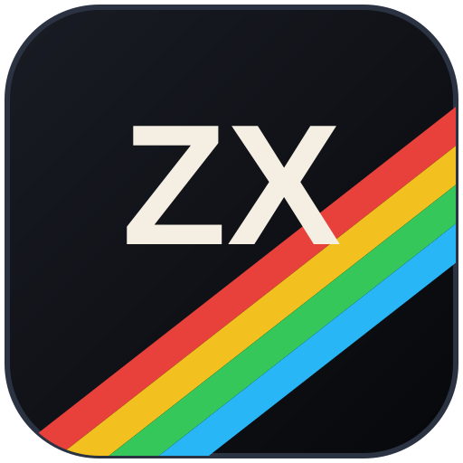
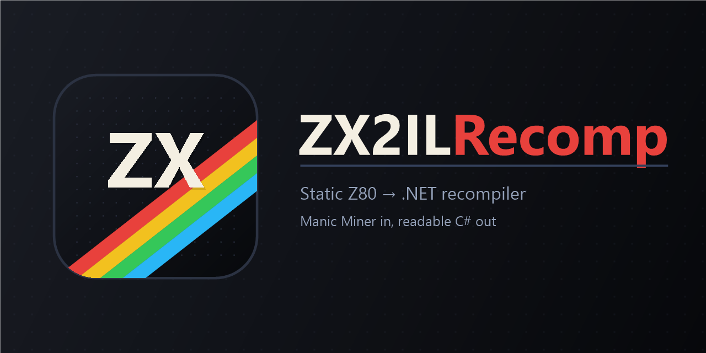

<div align="center">



# ZX2ILRecomp

**Static ZX Spectrum → .NET recompiler.** Feed it a `.z80` snapshot, get a runnable .NET game and readable C#.

[](https://github.com/dpteam/ZX2ILRecomp/actions/workflows/ci.yml)
[](https://dotnet.microsoft.com/)
[](#requirements)
[](LICENSE)
[](#no-third-party-libraries)
[](#supported-inputs)

</div>

---

## What it does

ZX2ILRecomp reads a ZX Spectrum snapshot, disassembles the Z80 program, and
translates every reachable instruction into equivalent C#. That C# is compiled
by the .NET SDK into a normal Windows game that renders through WinForms and
plays through `winmm`.

There is no Z80 interpreter in the hot path. Control flow becomes real C#
methods, one per original address, and a three-level dispatch table
(`pc >> 8` → page → address) walks them. An interpreter fallback still exists,
but only for addresses the static analysis could not prove reachable — and it
writes them to `dynamic_targets.log` so the next lift can inline them.

```
   game.z80
      │
      ├─► .z80 / .sna / .szx / .tap / .tzx loader ─► registers, banks, ROM
      │
      ├─► recursive descent + linear sweep ────────► instructions, labels, edges
      │                                              (decoded through real paging)
      │
      ├─► LifterZ80 ───────────────────────────────► C#: CPU, ULA, AY, keyboard
      │
      └─► dotnet publish ──────────────────────────► game.exe + game.dll (+ icon)
```

## Quick start

```powershell
git clone https://github.com/dpteam/ZX2ILRecomp.git
cd ZX2ILRecomp
dotnet build

# Just run it: the window opens.
dotnet run

# Prove the whole toolchain works. No game files needed.
dotnet run -- --selftest

# Or stay on the command line.
dotnet run -- "Manic Miner.z80" --full-exe
```

<div align="center">

</div>

## Interfaces

One pipeline, three front ends. Pick whichever fits the job.

| Interface | Launch | Best for |
|---|---|---|
| **GUI** | `ZX2ILRecomp` (or `--gui`) | picking a folder, watching a batch, reading the log |
| **TUI** | `ZX2ILRecomp` on a console without a desktop | servers, SSH, remote sessions |
| **CLI** | `ZX2ILRecomp <snapshot> [options]` | scripts, CI, one-off lifts |

With no arguments the tool opens the window. Explicit arguments always skip the
UI and behave exactly like the CLI, so scripts and CI never block on a prompt.

## Supported inputs

| Format | What is recovered |
|---|---|
| `.z80` | full register file, 48K and 128K (v1, v2, v3), compressed and raw blocks |
| `.sna` | full register file, 48K, plus the 128K extension when present |
| `.szx` | registers, RAM pages, ROM pages, paging latches |
| `.tap` | memory blocks and load address (a tape carries no registers) |
| `.tzx` | memory blocks and load address, all standard/turbo data blocks |

Models: **48K** and **128K** (including +2 paging through port `0x7FFD`).
The model is auto-detected from the container and can be forced with
`--model 48` or `--model 128`.

## What the generated game contains

* **CPU** — full Z80 including `IX`/`IY`, `CB`/`ED`/`DD`/`FD` pages, block
  moves, `DAA`, `NEG`, `RRD`/`RLD`, interrupt modes 0/1/2.
* **ULA** — 256×192 picture inside a border, correct bitmap interleaving,
  bright and flash attributes, both screens on 128K.
* **AY-3-8912** — three tone channels mixed into the beeper stream.
* **Keyboard** — the real 8×5 matrix, so `IN`/`OUT` polls work as written.
* **Window** — 2× nearest-neighbour blit, `F1` diagnostics overlay,
  `F2` sound, `Esc` to quit.
* **Headless mode** — `Game.exe --headless 600` runs 600 frames with no window
  and prints a summary. This is what CI uses.
* **Icon self-capture** — `Game.exe --capture-icon 5` screenshots itself into
  `<name>.icon.ico`, which the next lift picks up automatically.

## Output layout

```
<out>/<Name>/
  <Name>.exe              double-click to play (default packaging)
  <Name>.dll              lifted game assembly
  <Name>.icon.ico         icon captured from the running game
  src/Game.generated.cs   generated C#, readable and annotated
  analysis.txt            model, entry point, coverage, full disassembly
  dynamic_targets.txt     addresses to force into the next lift
```

## Packaging

| Flag | Result | Needs .NET installed |
|---|---|---|
| `--exe` (default) | `Game.exe` + `Game.dll` + deps | yes |
| `--dll` | `Game.dll` only, run with `dotnet Game.dll` | yes |
| `--full-exe` | single self-contained `.exe` (~70 MB) | no |

Aliases for `--full-exe`: `--self-contained`, `--standalone`.

## How the lift works

1. **Load.** The container is parsed into registers, ROM images and eight 16K
   RAM banks — a bank-oriented model, because that is the only representation
   that survives 128K paging.
2. **Fix up.** The model is applied first, then the ROM is located on disk,
   then the entry-point heuristics run. Order matters: a real snapshot may be
   paused inside a ROM call, and forcing `0x8000` there would break it.
3. **Analyse.** Recursive descent from the entry point, the RST vectors and the
   IM 1 handler, followed by a linear sweep over the rest of RAM. The sweep is
   what turns jump-table-driven games from "half interpreted" into fully static.
4. **Emit.** One method per address, plus a runtime carrying CPU helpers, the
   memory decoder, the ULA, the AY and the window.
5. **Package.** `dotnet publish` produces the apphost and embeds the icon.

Full detail: [docs/ARCHITECTURE.md](docs/ARCHITECTURE.md).

## No third-party libraries

Not a slogan — the whole point. The project references **zero** NuGet packages:

* no Roslyn → the .NET SDK's own `dotnet publish` compiles the generated C#
* no test framework → a 120-line assertion harness in `tests/`
* no audio library → `winmm` `waveOut` P/Invoke
* no imaging library → GDI+ and a hand-written ICO writer
* no UI framework → stock WinForms controls

That keeps the build reproducible, the download small, and the supply chain
empty.

## Verification

```powershell
dotnet run --project tests/ZX2ILRecomp.Tests      # unit tests
dotnet run -- --selftest --frames 60 --keep       # lift + package + run
```

`--selftest` builds a synthetic snapshot for every supported container, lifts
it, packages it, and **executes the result headlessly**, checking that it
reaches the frame budget without trapping. A loader regression, a broken opcode
table or a runtime that deadlocks on `HALT` all fail there.

## Requirements

* Windows 10 or later
* .NET 10 SDK (to lift) and the .NET 10 desktop runtime (to play `--exe` builds)

## Documentation

| Document | Contents |
|---|---|
| [docs/ARCHITECTURE.md](docs/ARCHITECTURE.md) | every stage of a lift, in order |
| [docs/SNAPSHOTS.md](docs/SNAPSHOTS.md) | container formats, bank mapping, ROM handling |
| [docs/RUNTIME.md](docs/RUNTIME.md) | what the generated game actually contains |
| [docs/TROUBLESHOOTING.md](docs/TROUBLESHOOTING.md) | games that hang, render wrong, or trap |
| [ROADMAP.md](ROADMAP.md) | what is next, including ZX80/ZX81 |

## Contributing

See [CONTRIBUTING.md](CONTRIBUTING.md). In short: `dotnet build -warnaserror`
must be clean, the tests and the self-test must pass, and no package references
may be added.

## License

GPL-3.0. See [LICENSE](LICENSE).
